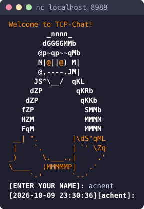
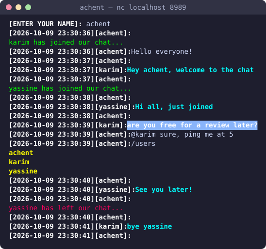
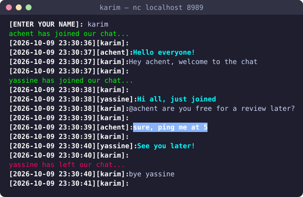
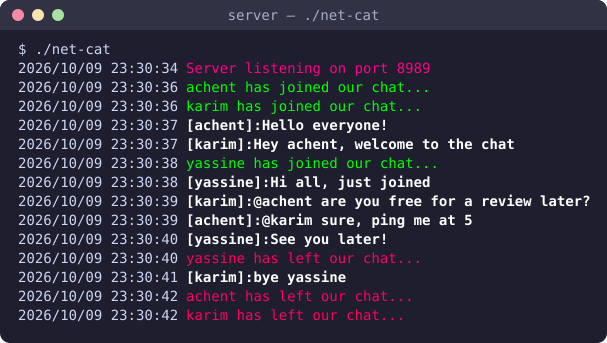

# Net-Cat

<div align="center">


**A lightweight terminal-based TCP chat server written in Go**

[Features](#-features) • [Installation](#-installation) • [Usage](#-usage) • [Commands](#-commands) • [Contributing](#-contributing)

</div>

---

## 📖 Overview

**Net-Cat** is a real-time messaging server designed for terminal enthusiasts. It supports multiple concurrent clients, colored output, private mentions, and essential chat commands—all through a simple TCP connection.

---

## 📸 Screenshots

### Joining the chat

<p align="center">
  
</p>

### A live conversation (two clients side by side)

Private mentions (`@username`) appear highlighted for the receiver only, and `/users` lists everyone connected.

<table>
  <tr>
    <th>achent's terminal</th>
    <th>karim's terminal</th>
  </tr>
  <tr>
    <td></td>
    <td></td>
  </tr>
</table>

### Server log

<p align="center">
  
</p>

---

## ✨ Features

- 💬 **Real-time messaging** between multiple clients
- 👥 **Single chat room** (all clients communicate together)
- 🎨 **ANSI-colored interface** for enhanced readability
- 📜 **Chat history** automatically sent to new joiners
- 🔒 **Input validation** for usernames and messages
- ⚡ **Concurrent handling** using Go goroutines
- 🎯 **Private mentions** with `@username` syntax
- 🛠️ **User commands** for renaming and listing users

---

## 💻 Installation

### Prerequisites

- **Go** 1.20 or higher
- **Git**
- Terminal with TCP client (`nc` or `telnet`)

### Build Instructions

```bash
# Clone the repository
git clone https://github.com/chentaymane/net-cat.git

# Navigate to project directory
cd net-cat

# Build the executable
go build -o net-cat main.go
```

---

## ⚡ Usage

### Starting the Server

Run the server with default port (8989):

```bash
./net-cat
```

Or specify a custom port:

```bash
./net-cat 8080
```

Output:
```
Listening on the port :8080
```

### Connecting Clients

Use **netcat** to connect:

```bash
nc localhost 8080
```

You'll be greeted with:

```
Welcome to TCP-Chat!
         _nnnn_
        dGGGGMMb
       @p~qp~~qMb
       M|@||@) M|
       @,---.JM|
      JS^\__/  qKL
     dZP        qKb
    dZP          qKb
   fZP            SMMb
   HZM            MMMM
   FqM            MMMM
 __| ".        |\dS"qML
 |    `.       | `' \Zq
_)      \.___.,|     .'
\____   )MMMMMP|   .'
     `-'       `--'

[ENTER YOUR NAME]:
```

---

## 📝 Commands

| Command | Description | Example |
|---------|-------------|---------|
| `/rename <new_name>` | Change your display name | `/rename RedFox` |
| `/users` | List all connected users | `/users` |
| `@username <message>` | Send a private mention | `@achent Hey there!` |

### Example Session

```
[ENTER YOUR NAME]: achent
[2026-01-17 20:50:25][achent]: Hello everyone!

karim has joined our chat...

[2026-01-17 20:50:48][karim]: @achent Hi there!
[2026-01-17 20:51:00][achent]: /rename RedFox
[2026-01-17 20:51:10][RedFox]: Welcome back!
[2026-01-17 20:52:05][karim]: /users

Connected users:
- RedFox
- karim
```

---

## 🏗️ Architecture

### Client Structure

```go
type Client struct {
    conn net.Conn  // TCP connection
    name string    // Unique username
}
```

### Core Components

| Function | Purpose |
|----------|---------|
| `HandleClient` | Manages individual client connections in separate goroutines |
| `broadcast` | Sends messages to all clients except the sender |
| `Tag` | Delivers private mentions to specific users |
| `Add` | Safely Add new clients |
| `Remove` | Safely removes disconnected clients |
| `Rename` | Updates client usernames with validation |
| `sendPrompt` | Displays timestamped input prompts |
| `validName` | Validates usernames (alphanumeric, max 10 chars) |
| `validMsg` | Validates messages (safe characters, max 100 chars) |

### Concurrency & Safety

- **Goroutines** handle multiple clients simultaneously
- **sync.RWMutex** protects shared resources (client map, chat history)
- Thread-safe operations for all client management

---

## 📂 Project Structure

```
net-cat/
│
├── main.go              # Entry point, TCP listener
├── functions/           # Core chat functionality
│   ├── broadcast.go    # Message broadcasting logic
│   ├── handleclient.go # Client connection handling
│   ├── Client.go       # Client functions
│   ├── sub-functions.go # Helper functions & utilities
│   └── vars.go         # Shared variables & types
├── screenshots/        # README screenshots
├── go.mod              # Go module definition
└── README.md           # This file
```

---

## 🔒 Security & Validation

### Username Rules
- Alphanumeric characters only
- Maximum 10 characters
- Must be unique
- No special characters or spaces

### Message Rules
- Maximum 100 characters
- Only safe ASCII characters allowed
- No control characters or malicious input

---

## 🤝 Contributing

Contributions are welcome! Follow these steps:

1. **Fork** the repository
2. **Create** a feature branch
   ```bash
   git checkout -b feature/amazing-feature
   ```
3. **Commit** your changes
   ```bash
   git commit -m 'Add amazing feature'
   ```
4. **Push** to the branch
   ```bash
   git push origin feature/amazing-feature
   ```
5. **Open** a Pull Request

---

## 📋 Requirements

- Go 1.20+
- Terminal with ANSI color support
- Network connectivity (localhost or LAN)

---

## 🎯 Roadmap (can be added)

- [ ] Multiple chat rooms
- [ ] Persistent chat history (database)
- [ ] User authentication
- [ ] File sharing support
- [ ] TLS/SSL encryption
- [ ] Web-based client interface

---

## 👨‍💻 Author

**achent** **ahaddou**

- GitHub: [@chentaymane](https://github.com/chentaymane) / [@mrshD3IM05](https://github.com/mrshD3IM05)
- Project: [net-cat](https://github.com/chentaymane/net-cat)

---

## ⚠️ Notes

- Currently supports **single chat room** only
- Requires terminal with **ANSI escape code** support
- Designed for **local network** or **localhost** use
- Lightweight and easy to extend

---

<div align="center">

**Built with ❤️ using Go**

⭐ Star this repo if you find it useful!

</div>
